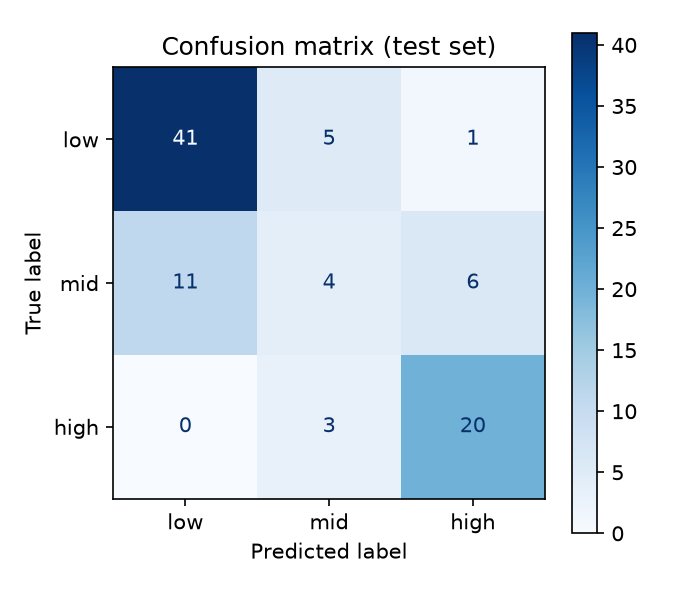
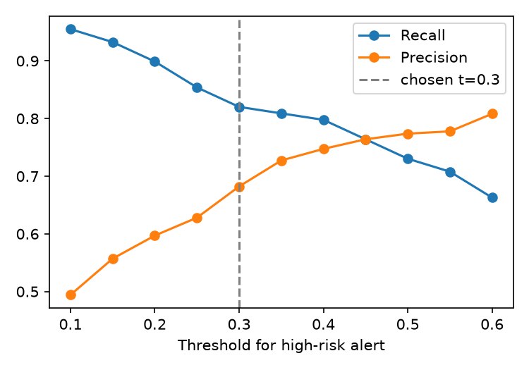
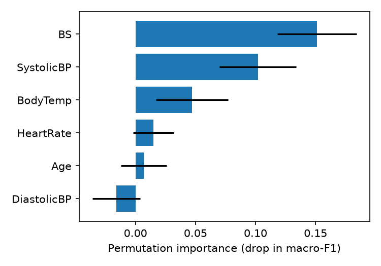

# MaternalRisk: Maternal Health Risk Classification

A machine learning pipeline and small dashboard that classifies maternal health risk (**low / mid / high**) from six vital signs, with a focus on **not missing high-risk cases** and on **honest evaluation**.

> **Key finding:** more than half of the rows in the public dataset are exact duplicates. Removing them lowered Random Forest cross-validated accuracy from **0.854 to 0.641**, so accuracy figures reported on the raw file are largely inflated by data leakage.

This is a research demonstration, not a medical device.

---

## Data

| Item | Detail |
|---|---|
| Source | UCI Machine Learning Repository, *Maternal Health Risk* (dataset 863) |
| Origin | Hospitals, community clinics and maternal health care in rural Bangladesh, collected through an IoT-based risk monitoring system |
| Features | Age, SystolicBP, DiastolicBP, BS (blood sugar, mmol/L), BodyTemp (°F), HeartRate |
| Target | RiskLevel: low, mid, high |
| Licence | CC BY 4.0 |

Citation: Ahmed M., Kashem M.A., Rahman M., Khatun S. (2020). *Review and Analysis of Risk Factor of Maternal Health in Remote Area Using the Internet of Things (IoT)*. Lecture Notes in Electrical Engineering, vol 632.

The data comes from Bangladesh, so results should not be assumed to hold for other populations.

### Data cleaning

| Step | Result |
|---|---|
| Rows in the CSV | 1,014 |
| Duplicate rows | 562 |
| Impossible values | 2 rows with a heart rate of 7 bpm removed |
| Unique rows kept | 451 |
| Rows with identical vital signs but different labels | 36 (label noise, so no model can be perfect) |

Class counts before and after removing duplicates:

| Class | Before | After |
|---|---|---|
| Low | 406 | 233 |
| Mid | 336 | 106 |
| High | 272 | 112 |

### Effect of duplicates (5-fold CV, Random Forest)

| Setting | Accuracy |
|---|---|
| With duplicates | 0.854 |
| Duplicates removed | 0.641 |

Duplicates let the same record appear in both the training and the test folds.

## Method

- **Split:** 80/20 stratified split of the unique rows (360 train, 91 test). The test set was used once, at the end.
- **Models:** Dummy baseline, Logistic Regression, Random Forest, Gradient Boosting, compared with 5-fold stratified CV repeated 3 times on the training set.
- **Selection criterion:** high-risk recall, chosen before looking at the test set, because missing a high-risk pregnancy is the most costly error.
- **Alert threshold:** the high-risk probability threshold (0.30) was chosen from out-of-fold predictions on the training set, not from the test set.
- **Uncertainty:** 95% bootstrap confidence intervals on the test set, because it is small.
- **Explanation:** permutation importance on the test set.

## Results

### Model comparison (training set, repeated CV)

| Model | Accuracy | Macro-F1 | High-risk recall |
|---|---|---|---|
| Dummy (baseline) | 0.517 | 0.227 | 0.000 |
| Logistic Regression | 0.593 | 0.549 | 0.640 ± 0.080 |
| **Random Forest (selected)** | 0.640 | 0.599 | 0.718 ± 0.131 |
| Gradient Boosting | 0.676 | 0.615 | 0.685 ± 0.129 |

The differences between Random Forest and Gradient Boosting are within the noise.

### Final test set (91 rows)

| Class | Precision | Recall | Cases |
|---|---|---|---|
| Low | 0.788 | 0.872 | 47 |
| Mid | 0.333 | 0.190 | 21 |
| High | 0.741 | 0.870 | 23 |

Accuracy 0.714. Macro-F1 0.624 (95% CI 0.53 to 0.72). High-risk recall 0.870 (95% CI 0.71 to 1.00).



No high-risk case was predicted as low risk in the test set.

### High-risk alert at threshold 0.30 (test set)

| | |
|---|---|
| High-risk cases caught | 21 of 23 |
| False alarms | 11 |
| Recall | 0.913 (95% CI 0.78 to 1.00) |
| Precision | 0.656 (95% CI 0.48 to 0.82) |

On the test set the threshold caught one more high-risk case than the default decision rule (21 versus 20) at the cost of four more false alarms. With 23 high-risk cases this difference is not statistically reliable. The stronger evidence is the training out-of-fold analysis below. A fair summary is a high-risk recall of roughly **0.8 to 0.9**.



| Threshold | Recall | Precision |
|---|---|---|
| 0.50 | 0.730 | 0.774 |
| 0.35 | 0.809 | 0.727 |
| **0.30** | **0.820** | **0.682** |
| 0.25 | 0.854 | 0.628 |
| 0.20 | 0.899 | 0.597 |

### Feature importance



Blood sugar and systolic blood pressure matter most. Heart rate, age and diastolic blood pressure have effects within the noise.

### Error analysis

- **Mid risk is the weak class** (4 of 21 correct). It has the fewest rows after cleaning and overlaps with both neighbours.
- **Both high-risk cases missed at the alert threshold had a body temperature of 101 °F with normal blood sugar.** The model relies mostly on blood sugar and blood pressure and gives temperature less weight. With two cases this is an observation, not a conclusion.

## Dashboard

```
streamlit run app.py
```

Tabs: **Risk check** (enter vital signs, see class probabilities and the high-risk alert), **Model report** (metrics, figures, error analysis) and **Data quality** (the duplicate-row analysis).

## Repository structure

```
.
├── maternal_risk.py        # cleaning, models, evaluation, figures, saves outputs
├── app.py                  # Streamlit dashboard
├── requirements.txt
├── maternal_rf.joblib      # trained Random Forest
├── maternal_clean.csv      # deduplicated data (CC BY 4.0, see Data)
├── cm.png  importance.png  threshold.png
└── README.md
```

## How to reproduce

```bash
pip install -r requirements.txt
```

1. Download `Maternal Health Risk Data Set.csv` from the UCI page (dataset 863) into the project folder.
2. Run `python maternal_risk.py`. It prints all results and saves the model, the cleaned data and the figures.
3. Run `streamlit run app.py`.

## Limitations

- Small dataset (451 unique rows) from one region, with no external validation.
- The test set has only 23 high-risk cases, so confidence intervals are wide.
- The mid-risk class is poorly predicted.
- 36 rows have conflicting labels, which sets a ceiling on achievable accuracy.
- The origin of the risk labels is not documented, so the model may be learning the labelling rule rather than clinical risk.
- Not a medical device and not for clinical use.

## Next steps

- Group-aware splitting so that near-identical records never straddle train and test.
- Calibration of predicted probabilities.
- Compare against simple rule-based screening on blood pressure and blood sugar.

## Authors 

* **Wasim Akram Janyaro** – Software Engineering graduate (Mehran University of Engineering and Technology). Interested in machine learning for public health. [waseemjanyaro@gmail.com]
* **Rizwan Rafique** – Software Engineering graduate (Mehran University of Engineering and Technology). [palijorizwanrafique746@gmail.com]